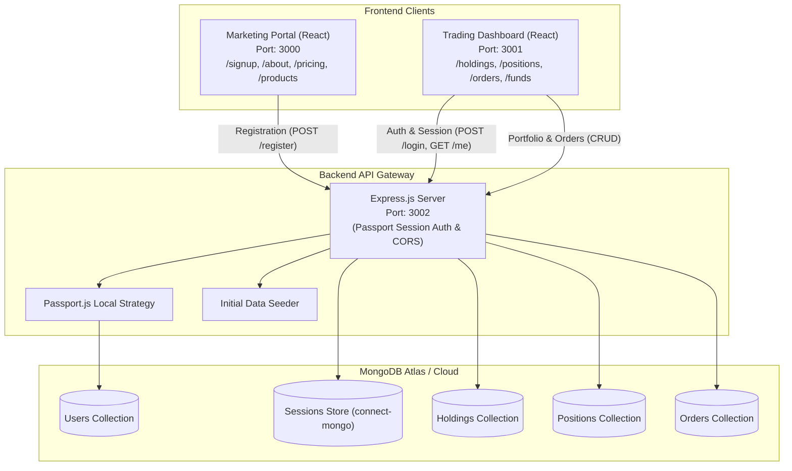

# ApexTrader 📈

[](https://react.dev/)
[](https://nodejs.org/)
[](https://expressjs.com/)
[](https://www.mongodb.com/)
[](https://react.dev/)
[](LICENSE)

**ApexTrader** is a modern, high-performance, full-stack MERN (MongoDB, Express, React, Node.js) trading and investment platform inspired by industry-leading broker architectures such as **Zerodha (Kite & Console)**. 

It delivers an end-to-end investment ecosystem featuring a dedicated corporate marketing and onboarding portal, an interactive real-time trading dashboard, robust portfolio analytics with Chart.js visualizations, paper trading order execution, margin management, and persistent session-based authentication with MongoDB store.

---

## 🌐 Live Deployments

| Component | Platform | Live URL |
| :--- | :--- | :--- |
| **Corporate / Landing Website** | Render | [https://apextrader-frontend-1.onrender.com](https://apextrader-frontend-1.onrender.com) |
| **Trading Dashboard** | Render | [https://apextrader-dashboard-1.onrender.com](https://apextrader-dashboard-1.onrender.com) |
| **Backend REST API** | Render | [https://apextrader-backend.onrender.com](https://apextrader-backend.onrender.com) |

---

## 📑 Table of Contents

- [Key Features](#-key-features)
- [System Architecture](#-system-architecture)
- [Project Directory Structure](#-project-directory-structure)
- [Technology Stack](#-technology-stack)
- [Getting Started & Local Setup](#-getting-started--local-setup)
  - [Prerequisites](#prerequisites)
  - [1. Backend Setup](#1-backend-setup)
  - [2. Trading Dashboard Setup](#2-trading-dashboard-setup)
  - [3. Frontend Landing Page Setup](#3-frontend-landing-page-setup)
- [Environment Variables](#-environment-variables)
- [API Reference](#-api-reference)
  - [Authentication](#authentication)
  - [Holdings](#holdings)
  - [Positions](#positions)
  - [Orders](#orders)
  - [Funds & Margin](#funds--margin)
- [Dashboard Modules Deep Dive](#-dashboard-modules-deep-dive)
- [Contributing](#-contributing)
- [License](#-license)

---

## 🚀 Key Features

### 🏢 1. Dedicated Marketing & Landing Portal (`frontend/`)
- **Brand Story & Ecosystem**: Interactive sections highlighting ApexTrader's suite of trading technology, pricing models, company about page, and 24/7 customer support.
- **User Onboarding**: Integrated client registration portal with form validation, password strength checks, and instant account creation synced to MongoDB.
- **Direct App Linkage**: Seamless navigation between marketing pages and the active trading console.

### 📊 2. High-Frequency Trading Console (`dashboard/`)
- **Live Market Watchlist**: Real-time ticker watchlist with percentage changes, up/down momentum indicators, dynamic search filter, and Chart.js Doughnut price distribution.
- **Order Placement Engine (Buy/Sell Window)**: Draggable order modal supporting both **BUY** and **SELL** orders with custom quantities, limit prices, and market executions.
- **Holdings Management**: Comprehensive portfolio ledger detailing Instrument, Qty, Average Cost, LTP (Last Traded Price), Current Value, P&L, Net change, and Day change alongside interactive Vertical Bar Chart analytics.
- **Open Positions Tracking**: Intraday and CNC (Cash 'N Carry) position tracker calculating real-time profit and loss metrics.
- **Orders Book**: Live transaction history log tracking placed orders, order modes, execution status, and instant cancellation actions.
- **Funds & Margin Simulator**: Equity balance tracker providing metrics on Available Margin, Used Margin, Available Cash, Opening Balance, Collateral, Exposure, and SPAN margin with simulated instant deposit and withdrawal actions.
- **Indices Bar**: Real-time market pulse displaying benchmark movements for **NIFTY 50** and **SENSEX**.

### 🔐 3. Backend & Security Architecture (`backend/`)
- **Passport.js Session Authentication**: Secure cookie-based authentication with `passport-local` and `passport-local-mongoose`.
- **Persistent Mongo Session Store**: Uses `connect-mongo` to maintain persistent, distributed user sessions across server restarts.
- **Auto-Seeding Database**: Pre-seeds initial market holdings and active positions automatically on first database connection.
- **Dynamic CORS Integration**: Pre-configured cross-origin resource sharing allowing multi-port local development (`3000`, `3001`, `3002`, `5173`) and secure production origin binding with `credentials: true`.

---

## 🏗 System Architecture



---

## 📂 Project Directory Structure

```text
ApexTrader/
├── backend/                         # Express.js REST API Server
│   ├── models/                      # Mongoose data models
│   │   ├── HoldingsModel.js         # Holdings schema model
│   │   ├── OrdersModel.js           # Trade orders schema model
│   │   ├── PositionsModel.js        # Open positions schema model
│   │   └── UserModel.js             # User auth schema with passport-local-mongoose
│   ├── schemas/                     # Mongoose validation schemas
│   │   ├── HoldingSchema.js
│   │   ├── OrdersSchema.js
│   │   ├── PositionsSchema.js
│   │   └── UserSchema.js
│   ├── .env                         # Server environment variables
│   ├── index.js                     # Main application entry, controllers & routes
│   └── package.json
│
├── dashboard/                       # React Trading Terminal (Port 3001)
│   ├── public/                      # Static assets & index.html
│   ├── src/
│   │   ├── components/              # Core trading UI components
│   │   │   ├── BuyActionWindow.js   # Draggable Buy/Sell order placement modal
│   │   │   ├── BuyActionWindow.css  # Order window styling
│   │   │   ├── Dashboard.js         # Main trading layout container & sub-routes
│   │   │   ├── DoughnoutChart.js    # Chart.js Watchlist distribution doughnut
│   │   │   ├── Funds.js             # Equity margin & fund transfer console
│   │   │   ├── GeneralContext.js    # Global context provider (Buy window state)
│   │   │   ├── Holdings.js          # Portfolio holdings table & analytics
│   │   │   ├── Home.js              # Auth-protected shell & user state loader
│   │   │   ├── Login.js             # Embedded login interface for dashboard
│   │   │   ├── Menu.js              # Navigation menu & profile dropdown
│   │   │   ├── Orders.js            # Executed orders book & cancellation
│   │   │   ├── Positions.js         # Intraday/delivery open positions table
│   │   │   ├── Summary.js           # Account overview, P&L, & equity summary
│   │   │   ├── TopBar.js            # Top indices ticker bar (NIFTY / SENSEX)
│   │   │   ├── VerticalGraph.js     # Stock prices vertical bar chart
│   │   │   └── WatchList.js         # Dynamic search ticker watchlist
│   │   ├── data/
│   │   │   └── data.js              # Mock fallback data for holdings & watchlist
│   │   ├── api.js                   # Axios HTTP client withCredentials setup
│   │   ├── index.css                # Trading terminal global styles
│   │   └── index.js                 # React DOM mount point
│   ├── .env                         # PORT=3001
│   └── package.json
│
├── frontend/                        # React Marketing & Landing Portal (Port 3000)
│   ├── public/                      # Static assets & favicon
│   ├── src/
│   │   ├── landing_page/            # Marketing site modules
│   │   │   ├── about/               # Team & Company info
│   │   │   ├── home/                # Hero banner, ecosystem preview & education
│   │   │   ├── pricing/             # Brokerage charges & fee transparency
│   │   │   ├── products/            # Technology product offerings
│   │   │   ├── signup/              # Account registration portal
│   │   │   ├── support/             # Helpdesk & knowledge base tickets
│   │   │   ├── Footer.js            # Shared global footer
│   │   │   ├── Navbar.js            # Top navigation bar
│   │   │   └── Notfound.js          # 404 handler page
│   │   ├── index.css                # Marketing site styling
│   │   └── index.js                 # React router initialization
│   └── package.json
│
├── .gitignore                       # Git ignore configuration
└── README.md                        # Project documentation
```

---

## 🛠 Technology Stack

### Frontend & Dashboard
- **React.js (v19)**: Component-driven user interfaces.
- **React Router DOM (v7 / v8)**: Client-side declarative routing and deep-linking.
- **Axios**: HTTP client configured for cross-origin credentialed requests.
- **Material-UI (MUI & MUI Icons)**: Clean icons and interactive tooltips.
- **Chart.js & react-chartjs-2**: High-performance interactive doughnut and vertical bar charts.
- **Bootstrap 5 & Custom CSS**: Responsive UI, flexible layouts, and custom trading themes.

### Backend & Database
- **Node.js**: Asynchronous JavaScript runtime environment.
- **Express.js (v5)**: Minimalist RESTful API framework.
- **MongoDB & Mongoose (v9)**: Document database and Object Data Modeling (ODM).
- **Passport.js & passport-local-mongoose**: Robust authentication and hashing strategy.
- **connect-mongo & express-session**: MongoDB-backed session persistence.
- **cors & dotenv**: Cross-origin resource configuration and environment management.

---

## ⚙️ Getting Started & Local Setup

### Prerequisites
- [Node.js](https://nodejs.org/) (v18.0.0 or higher recommended)
- [npm](https://www.npmjs.com/) or [yarn](https://yarnpkg.com/)
- [MongoDB](https://www.mongodb.com/) (Local instance or MongoDB Atlas connection string)

### 1. Backend Setup

1. Open a terminal and navigate to the `backend` folder:
   ```bash
   cd backend
   ```
2. Install dependencies:
   ```bash
   npm install
   ```
3. Configure your environment variables by creating a `.env` file in `backend/`:
   ```env
   PORT=3002
   MONGO_URL=mongodb+srv://<username>:<password>@cluster.mongodb.net/apextrader?retryWrites=true&w=majority
   SESSION_SECRET=your_super_secret_session_key
   NODE_ENV=development
   ```
4. Start the backend development server (with nodemon):
   ```bash
   npm start
   ```
   *The server will run on [http://localhost:3002](http://localhost:3002).*

---

### 2. Trading Dashboard Setup

1. Open a second terminal and navigate to the `dashboard` folder:
   ```bash
   cd dashboard
   ```
2. Install dependencies:
   ```bash
   npm install
   ```
3. Verify or configure `dashboard/.env`:
   ```env
   PORT=3001
   REACT_APP_API_URL=http://localhost:3002
   ```
4. Start the dashboard application:
   ```bash
   npm start
   ```
   *The trading dashboard will open on [http://localhost:3001](http://localhost:3001).*

---

### 3. Frontend Landing Page Setup

1. Open a third terminal and navigate to the `frontend` folder:
   ```bash
   cd frontend
   ```
2. Install dependencies:
   ```bash
   npm install
   ```
3. (Optional) Create a `frontend/.env` file if you wish to override defaults:
   ```env
   PORT=3000
   REACT_APP_API_URL=http://localhost:3002
   ```
4. Start the marketing and signup app:
   ```bash
   npm start
   ```
   *The landing page will open on [http://localhost:3000](http://localhost:3000).*

---

## 🔑 Environment Variables

### Backend (`backend/.env`)
| Variable | Description | Default / Example |
| :--- | :--- | :--- |
| `PORT` | Port for the Express backend server | `3002` |
| `MONGO_URL` | MongoDB connection URI (Atlas or local) | `mongodb://localhost:27017/apextrader` |
| `SESSION_SECRET` | Secret key used to sign session cookies | `apextrader_secret_key` |
| `NODE_ENV` | Environment mode (`development` or `production`) | `development` |
| `BYPASS_AUTH` | Optional toggle for development auth bypass | `false` |

### Dashboard (`dashboard/.env`)
| Variable | Description | Default / Example |
| :--- | :--- | :--- |
| `PORT` | Local port for React development server | `3001` |
| `REACT_APP_API_URL` | Base URL of the backend API | `http://localhost:3002` |

### Frontend (`frontend/.env`)
| Variable | Description | Default / Example |
| :--- | :--- | :--- |
| `PORT` | Local port for React development server | `3000` |
| `REACT_APP_API_URL` | Base URL of the backend API | `http://localhost:3002` |

---

## 📡 API Reference

All protected endpoints require an authenticated session cookie or an authorization header.

### Authentication
| Method | Endpoint | Description | Payload Example |
| :--- | :--- | :--- | :--- |
| `POST` | `/register` | Create a new user account | `{"username": "trader1", "email": "trader@example.com", "password": "password123"}` |
| `POST` | `/login` | Authenticate and initiate session | `{"username": "trader1", "password": "password123"}` |
| `GET` / `POST` | `/logout` | Terminate session and destroy cookie | None |
| `GET` | `/me` | Retrieve authenticated user profile | None |

### Holdings
| Method | Endpoint | Description | Payload Example |
| :--- | :--- | :--- | :--- |
| `GET` | `/allHoldings` | Fetch all portfolio holdings | None |
| `POST` | `/addHolding` | Add a new stock holding | `{"name": "TCS", "qty": 5, "avg": 3200, "price": 3250}` |
| `DELETE`| `/deleteHolding/:id`| Remove a holding by ID | None |

### Positions
| Method | Endpoint | Description | Payload Example |
| :--- | :--- | :--- | :--- |
| `GET` | `/allPositions` | Fetch all open positions | None |
| `POST` | `/addPosition` | Create a new position | `{"product": "CNC", "name": "INFY", "qty": 2, "avg": 1400, "price": 1420}` |
| `DELETE`| `/deletePosition/:id`| Close / delete position by ID | None |

### Orders
| Method | Endpoint | Description | Payload Example |
| :--- | :--- | :--- | :--- |
| `GET` | `/allOrders` | Retrieve historical order logs | None |
| `POST` | `/newOrder` | Place a new Buy or Sell order | `{"name": "RELIANCE", "qty": 10, "price": 2450.50, "mode": "BUY"}` |
| `DELETE`| `/deleteOrder/:id` | Cancel an order by ID | None |

### Funds & Margin
| Method | Endpoint | Description | Payload Example |
| :--- | :--- | :--- | :--- |
| `GET` | `/funds` | Fetch margin balances and equity limits | None |
| `POST` | `/funds` | Deposit or withdraw funds | `{"amount": 1000, "action": "add"}` / `{"action": "withdraw"}` |

---

## 📈 Dashboard Modules Deep Dive

| Module | Route | Functionality |
| :--- | :--- | :--- |
| **Summary** | `/` | Aggregates overall equity margin, total investment cost, current market value, and total portfolio P&L percentage. |
| **Orders** | `/orders` | Displays executed orders with color-coded badges (`BUY` in blue, `SELL` in orange) and an instant cancel button. |
| **Holdings** | `/holdings` | Tabular analysis of stock quantities, average purchase prices, live LTP, current valuations, profit/loss, and dynamic Bar Chart visualization. |
| **Positions** | `/positions` | Intraday and delivery positions tracking with product types (e.g. `CNC`, `MIS`). |
| **Funds** | `/funds` | Granular breakdown of equity margin (Available Margin, Used Margin, Available Cash, Payin, SPAN, Collateral). Offers one-click UPI simulated fund top-up and withdrawal. |
| **Watchlist** | *Sidebar* | Quick search bar filtering through 50+ equities with interactive price indicators, quick action Buy/Sell buttons, and Doughnut distribution. |

---

## 🔒 Security Best Practices Implemented
- **Hashed Passwords**: Password hashing and salting managed securely via `passport-local-mongoose`.
- **HTTP-Only Cookies**: Session cookies marked `httpOnly: true` with dynamic `sameSite` configuration for cross-domain support.
- **CORS Protection**: Whitelisted origin rules strictly regulating API access from authorized hosts.
- **Input Sanitization**: Built-in express url-encoding and JSON parsing safeguards.

---

## 🤝 Contributing

Contributions, issues, and feature requests are welcome!
1. Fork the Project.
2. Create your Feature Branch (`git checkout -b feature/AmazingFeature`).
3. Commit your Changes (`git commit -m 'Add some AmazingFeature'`).
4. Push to the Branch (`git push origin feature/AmazingFeature`).
5. Open a Pull Request.

---

## 📄 License

Distributed under the **ISC License**. See `LICENSE` for more information.

---

<p align="center">
  Built with ❤️ for traders and developers. Inspired by Zerodha.
</p>
